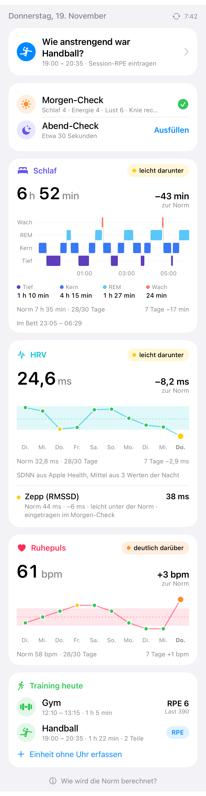
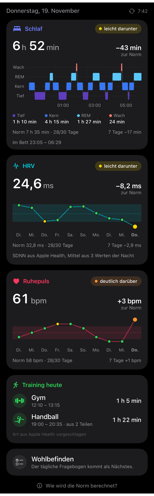

# Cockpit

A personal iOS training dashboard that reads sleep, heart rate variability and resting heart rate from Apple Health, compares them against your **own** baseline, and exports clean, versioned weekly reports for training planning.

> **Status:** Phase 1 in progress. Health import, personal baselines, the daily card, check-ins, session RPE, the daily CSV export, load monitoring and the weight trend are done; the weekly report is next. See the [roadmap](#roadmap).

<p align="center">
  
  &nbsp;&nbsp;
  
</p>
<p align="center"><sub>Rendered with synthetic data (<code>scripts/screenshots.sh</code>).</sub></p>

## Why

Wearables produce a lot of numbers, but most apps condense them into an opaque “readiness score”. Cockpit takes the opposite approach:

- **Raw deviations instead of a black-box score.** It shows how today's values differ from your personal 7- and 30-day norm. A score will only be added once it has been validated against real data.
- **Clean data for planning.** Instead of screenshots, the app exports a compact weekly report (JSON + Markdown) with explicit data-quality notes.
- **A dataset for a data-science question.** Does a readiness measure predict how you feel the next day better than simple baselines? The app is built so that this can be answered honestly later (stable question IDs, versioned schemas, source per value, missing values stay `null`).

## Features

| | Feature | Status |
|---|---|---|
| 🔍 | **Health Explorer:** shows which Apple Health data actually arrives, from which source and device, how often, at what time of day, and where the gaps are. Exports a Markdown summary. | ✅ Done |
| 📥 | **Apple Health import:** 90 days of history on first launch, then incremental with a 3-day overlap for late syncs. Per wake day: sleep window and stages, raw nightly HRV samples plus their mean, resting heart rate. Workouts are de-duplicated by HealthKit UUID and grouped into suggested sessions. | ✅ Done |
| 📏 | **Personal baselines:** 30-day norm (median of the days *before*, at least 14 values) and 7-day trend. Deviations as a difference in the metric's unit and as a robust z-score (scaled MAD, HRV on log scale) with transparent thresholds. | ✅ Done |
| 📊 | **Daily card:** last night's sleep as a hypnogram with minutes per stage; HRV and resting heart rate over the last 10 days with the norm range as a band (gaps stay gaps); today's training. Deviations are coloured green/yellow/orange by their likely effect, and the method is explained in the app. | ✅ Done |
| 📝 | **Check-ins:** morning (wellbeing scales based on the Hooper index, illness with symptoms, pain per body region and side, optional weight and tracker HRV), energy at noon, and evening (knee in everyday life, pain, nutrition, caffeine, alcohol). Versioned question catalog with stable IDs, conditional follow-ups, missing answers stay `null`. Past days can be reviewed and filled in; the evening check counts for the previous day until 4 a.m. | ✅ Done |
| 🏋️ | **Session RPE:** Borg CR10 per session (prompted 30 min after a workout ends), session load = RPE × duration, knee pain during the session, handball match/practice, minutes played and throwing volume. Wrongly detected workouts can be hidden. | ✅ Done |
| 🔔 | **Reminders:** local notifications for weigh-in days, the morning check, noon (answer 1–5 right in the notification) and the evening check, skipped once done. HealthKit background delivery wakes the app when a new workout arrives and schedules the RPE prompt. Tapping a notification opens the right form. | ✅ Done |
| 📤 | **Daily CSV export:** one row per day, empty = not captured, units in column names, append-only columns. Written automatically into a file linked once via the Files app, e.g. in a cloud folder the planning reads. | ✅ Done |
| 📈 | **Load monitoring and weight:** weekly load by session type, daily load next to knee pain, acute vs. chronic load (with a caveat on ACWR), Foster's monotony and strain, throwing volume per week; weight trend from irregular weigh-ins. | ✅ Done |
| 📤 | **Weekly report:** versioned JSON + Markdown export | 🚧 Next |
| 📅 | Import of the planned training week (CSV), session RPE, configurable rule hints | Phase 2 |

## Design decisions

- **Local-first:** All health data stays on the device (SwiftData). No backend, no accounts, no tracking. The only exception is the daily CSV, which is written into a file the user links deliberately.
- **Versioned data:** The SwiftData schema is versioned (V1 → V2 → V3, each with a frozen copy of the changed models and a migration test, plus a backup before every migration), because check-in answers cannot be re-imported. Question and scale versions are stored with every answer.
- **Read-only HealthKit:** Cockpit never writes to Apple Health.
- **Honest about missing data:** Missing values are shown and exported as `null`, never as `0` and never interpolated. iOS does not reveal whether read access was denied, so “no data” is always labelled as ambiguous.
- **Sources and metrics are never mixed:** Several apps can write the same metric. Each value keeps its source, and only one source per metric is used. HRV is stored as `healthkit_sdnn`, because tracker apps often show RMSSD in their own UI, and the two are not comparable.
- **Local calendar days:** Every metric is stored per local day; a night belongs to the day you wake up. This is tested across daylight-saving changes.
- **Hints, not decisions:** The app makes no medical statements.

## Tech stack

- Swift 6 (approachable concurrency, `MainActor` by default), iOS 17+
- SwiftUI, SwiftData, Swift Charts, HealthKit
- Swift Testing for unit tests; analysis code runs on plain value types, so it is tested with synthetic data and no HealthKit
- [XcodeGen](https://github.com/yonaskolb/XcodeGen): the Xcode project is generated from [`project.yml`](project.yml) and not checked in
- Developed in VS Code with the Swift extension and [SweetPad](https://sweetpad.hyzyla.dev); no third-party dependencies in the app

## Project structure

```
Cockpit/
  App/                 App entry point
  Core/
    Data/              SwiftData models, versioned schema
    Health/            HealthKit access, import, sync
    Questionnaire/     Versioned question catalog and answer values
    Export/            Daily CSV (unit-tested) and writing to the linked file
    Reminders/         Notification planning (unit-tested) and scheduling
    Metrics/           Pure logic: daily values, baselines, workout grouping (unit-tested)
  Features/
    Dashboard/         Daily card and sync status
    Questionnaire/     Check-ins and session logging
    Data/              Stored days for spot checks, shared training data
    Export/            Linking and status of the CSV export
    History/           Load monitoring and weight trend
    HealthExplorer/    Data source analysis and report
  Resources/           Asset catalog
CockpitTests/          Unit tests (synthetic data only)
scripts/               Test and device deployment scripts
DASHBOARD_APP_SPEC.md  Full specification
```

## Getting started

Requirements: macOS with Xcode 26+, [Homebrew](https://brew.sh).

```bash
brew install xcodegen xcbeautify
xcodegen generate
scripts/test.sh               # build and run unit tests in the simulator
scripts/screenshots.sh        # render the daily card with synthetic data
```

To run on an iPhone, set your own `DEVELOPMENT_TEAM` and bundle ID prefix in `project.yml`, connect the phone and run:

```bash
scripts/deploy-device.sh
```

With a free Apple developer account the signature expires after 7 days. Running the script again re-signs the app, and its data is kept.

## Roadmap

1. **Data and daily card:** HealthKit access ✅, Health Explorer ✅, Apple Health import ✅, baselines with tests ✅, daily card ✅, check-ins and session RPE ✅, JSON export
2. **Plan and report:** CSV import of the training week, session RPE, weekly report JSON + Markdown, rule hints
3. **Extensions:** gym logging (e1RM, rest timer / Live Activity), spreadsheet sync via API, charts and analyses

## Privacy

This repository contains no real health data. All test data is synthetic. Exported reports contain sensitive data and are meant to be shared deliberately.
